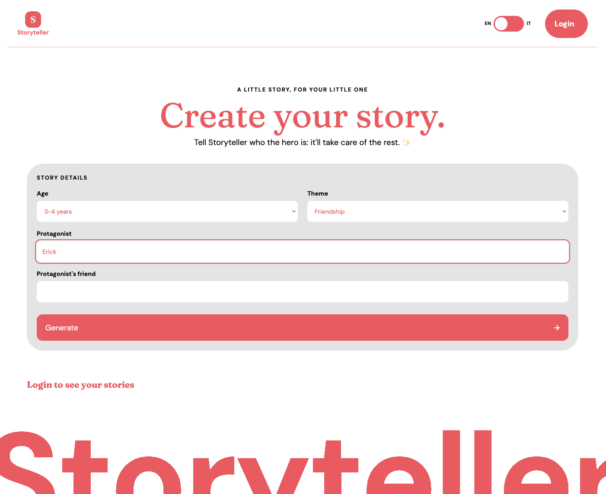

# Storyteller

A web app that writes personalised bedtime stories for children aged 2 to 5.
Pick an age range, a theme and the names of the hero and their friend: an AI writes a short, gentle story in English or Italian, and you can save your favourites to read again later.



## Features

- **AI story generation** with Google Gemini, tailored to age range, theme and characters
- **English / Italian** interface and stories, with localised dates (next-intl)
- **Passwordless login** with a magic link (Supabase Auth)
- **Saved stories** stored per user, protected by Row Level Security
- **Story library**: responsive card grid, read a story in a modal, delete with confirmation
- **Responsive layout**: form and story side by side on desktop, stacked on mobile
- **Accessibility**: labelled form fields, native `<dialog>` modal, keyboard-scrollable story panel, announced status and error messages, visible focus styles

## Tech stack

| Area       | Tools                                                                       |
| ---------- | --------------------------------------------------------------------------- |
| Framework  | Next.js 14 (Pages Router), React, TypeScript                                |
| Styling    | SCSS modules, Sass `@use` / `@forward` with shared mixins and design tokens |
| i18n       | next-intl                                                                   |
| Backend    | Supabase (Auth + Postgres with RLS), Next.js API route                      |
| AI         | Google Gemini API                                                           |
| Fonts      | DM Sans and Fraunces via `next/font`                                        |
| Deployment | Vercel (preview deploy for every branch)                                    |

## Project structure

```
src/
├── components/
│   ├── Atoms/       # Button, Input, Switch, Toast…
│   ├── Molecules/   # Header, Footer, InputBox, SelectBox, StoryCard, StoryMeta, StoryModal…
│   └── Organism/    # WindowBox, StoryForm, StoryResult, StoriesSection
├── hooks/           # useUser, useStories, useGoToLogin
├── lib/             # Supabase client
├── pages/           # index, login, api/generateStory
└── styles/          # global styles, tokens, mixins
messages/            # en.json, it.json
```

Components follow an atomic design structure. State lives in the page (`index.tsx`) and is passed down as props; data access is wrapped in custom hooks.

## Running locally

1. Clone the repo and install dependencies:
   ```bash
   git clone https://github.com/giadantioco/ai-story-teller.git
   cd ai-story-teller
   npm install
   ```
2. Copy `.env.example` to `.env.local` and fill in your keys:
   ```bash
   # TODO: check these names match your .env.local
   NEXT_PUBLIC_SUPABASE_URL=
   NEXT_PUBLIC_SUPABASE_ANON_KEY=
   GEMINI_API_KEY=
   ```
3. In Supabase, create a `stories` table and enable Row Level Security with a policy that lets users manage only their own rows.
4. Start the dev server:
   ```bash
   npm run dev
   ```
   and open [http://localhost:3000](http://localhost:3000).

## What I learned

- Splitting a large page into focused components and deciding where state should live
- Typing props, setters and callbacks in TypeScript
- Working with Supabase Auth, RLS policies and their silent failures
- Responsive layouts with CSS Grid, `:has()` and `contain: size`
- Accessible patterns for forms, modals and dynamic messages
- A branch → preview deploy → pull request → merge workflow on Vercel

## Roadmap

- Loading state for saved stories
- Cat-shaped story cards 🐱
- Custom SMTP for login emails

---

Made by [Giada Antioco](https://github.com/giadantioco)
